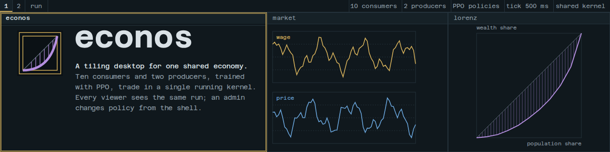
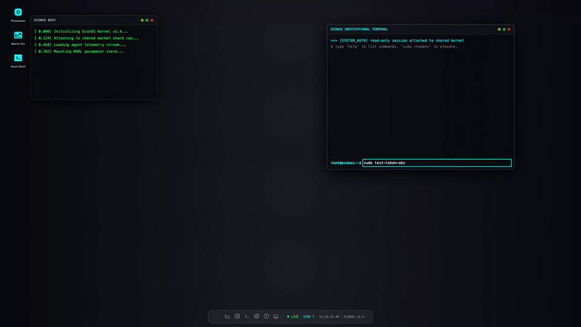
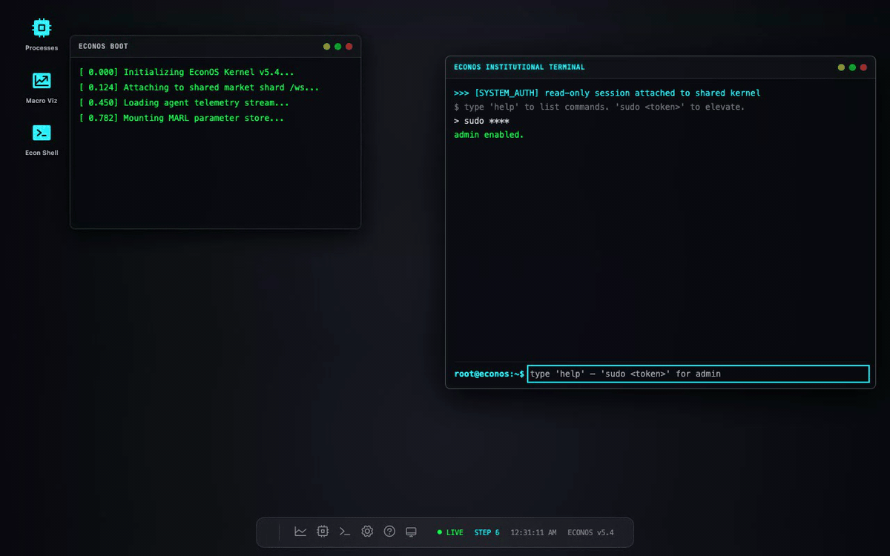
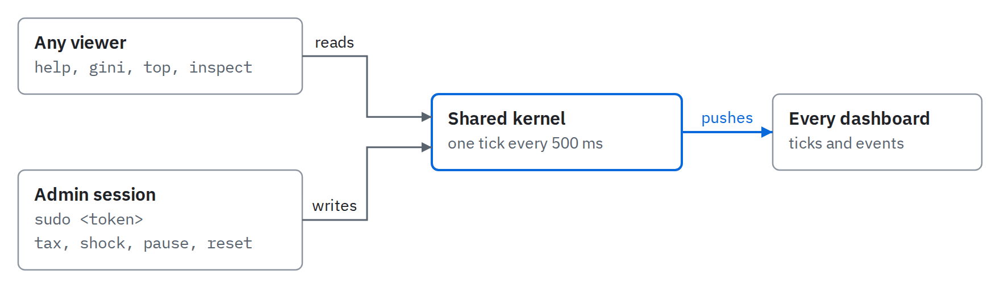

<p align="center">
  <picture>
    <source media="(prefers-color-scheme: dark)" srcset="docs/banner.png">
    <source media="(prefers-color-scheme: light)" srcset="docs/banner-light.png">
    
  </picture>
</p>

# EconOS | Economic Operating System

[](https://github.com/Builder106/econ-os/actions/workflows/ci.yml)
[](https://www.python.org/)
[](LICENSE)
[](https://github.com/Builder106/econ-os/actions/workflows/ci.yml)
[](https://pettingzoo.farama.org/)
[](https://fastapi.tiangolo.com/)
[](https://econ-os.vercel.app)

> **A virtual sandbox economy powered by learning AI citizens.** Test financial policies, tax rates, and market rules in real time.

## 💡 What is EconOS?

Testing new economic policies in the real world is unpredictable. EconOS creates a virtual world populated by dozens of independent AI agents acting as buyers, sellers, and workers. It provides a flight-simulator dashboard for researchers to test rules, tax rates, and market shocks safely before applying them in real life.

EconOS treats economic agents as system processes, providing a glassmorphic desktop interface to monitor and interact with emergent market behaviors. Using reinforcement learning (PPO), agents discover pricing, wage-setting, and consumption strategies within a closed-loop economy.

**Live demo:** [econ-os.vercel.app](https://econ-os.vercel.app) (multi-tenant shared mainframe where every visitor observes the simulation in real time). The dashboard ships with dark and light themes that cycle via the taskbar moon icon.

<details>
<summary><b>Fed mode: admin tax changes propagate from shell to Policy Manager</b></summary>

After `sudo <token>` elevates permissions, entering `tax 25` in the shell updates the running simulation kernel, and the Policy Manager UI updates to 25.00% on the next tick.

<picture>
  <source media="(prefers-color-scheme: dark)" srcset="docs/media/02-admin-tax-propagation-dark.gif">
  <source media="(prefers-color-scheme: light)" srcset="docs/media/02-admin-tax-propagation-light.gif">
  
</picture>

</details>

<details>
<summary><b>Broadcast events: economic shocks visible to every viewer</b></summary>

`shock wage 10` issued by one user's terminal broadcasts an administrative event to every connected viewer. The simulation kernel applies the wage change on the next tick.

<picture>
  <source media="(prefers-color-scheme: dark)" srcset="docs/media/03-admin-shock-broadcast-dark.gif">
  <source media="(prefers-color-scheme: light)" srcset="docs/media/03-admin-shock-broadcast-light.gif">
  
</picture>

</details>

## User Flow

Every visitor lands in the same shared environment: the shared simulation ticks continuously regardless of how many people are watching. Authenticated administrators can adjust market parameters (taxes, price shocks, pauses) that broadcast in real time to every connected user.

<picture>
  <source media="(prefers-color-scheme: dark)" srcset="assets/diagrams/user-flow-dark.png">
  
</picture>

Every viewer sees the same kernel tick every 500 ms. Visitors can watch the monitors, take the tour, or use read-only shell commands. A valid `sudo` token unlocks tax changes, wage or price shocks of ±5% or ±10%, and pause, resume, or reset commands. Their ADMIN events broadcast to every connected viewer. Invalid tokens leave the visitor on the read-only path. [Editable HTML source](assets/diagrams/user-flow.html).

The feedback loop ensures that one user's policy adjustment immediately reflects on every other visitor's dashboard.

## Key Features

- **EconOS Desktop**: A custom, library-free window management system in vanilla JS.
- **MARL Core**: Built on [PettingZoo](https://pettingzoo.farama.org/) and [Stable-Baselines3](https://stable-baselines3.readthedocs.io/).
- **Economic Invariants**: Mathematically verified closed-loop economy (No money leakage).
- **Process Explorer**: Monitor agent "memory" (wealth) and "status" (RL policy state) in real-time.
- **Root Shell**: Interactive terminal for kernel commands (`tax`, `shock`, `redistribute`), policy overrides, and Fed mode.
- **UBI Fiscal Mechanics**: Universal Basic Income redistribution command (`redistribute`) disbursing treasury tax revenue to active consumer agents.
- **Deep Macro Analytics**: Real-time Gini Index, Lorenz Curves, CPI tracking, and Real GDP calculation.

## Architecture

- **`simulation/`**: Core Gym/PettingZoo environment and economic logic.
- **`dashboard/`**: Glassmorphic terminal interface (Tailwind + Chart.js).
- **`logic.py`**: Mathematical bedrock (Utility, Production functions).

## Getting Started

1. **Setup**:

   ```bash
   uv sync --group dev
   ```

2. **Run Simulation**:

   ```bash
   python3 simulation/train.py
   ```

3. **View Dashboard**:

   Open `dashboard/index.html` in your browser.

## CI/CD Pipeline

The dashboard deploys from CI, and the kernel is updated by hand. The two meet only over a WebSocket.

A push to `main` starts CI. The secret scan, Python checks, and Playwright job gate the Vercel production hook, which builds the static dashboard with `ECONOS_KERNEL_WS_URL`. The shared kernel is updated separately with `git pull` and `docker compose up -d`; the dashboard connects to its WebSocket endpoint.

| Stage | Trigger | What runs | Where it shows up |
| --- | --- | --- | --- |
| **CI: secret scan and pytest** | Push to `main` or `staging`, or a PR to `main` | Gitleaks, Python audits, build and lint checks, and pytest with coverage | [Actions tab](https://github.com/Builder106/econ-os/actions) and CI badge |
| **CI: Playwright** | After the pytest job passes | TypeScript checks, dependency audit, generated Gherkin specs, and browser tests | Same Actions run; failure artifacts are uploaded |
| **CD: Vercel frontend** | Passing CI on a push to `main` or `staging` | The deploy hook runs [`scripts/build-config.js`](scripts/build-config.js) to write `dashboard/config.js` from `ECONOS_KERNEL_WS_URL` | [econ-os.vercel.app](https://econ-os.vercel.app) for production |
| **CD: shared kernel** | Manual | SSH to the host, pull source, then run `docker compose up -d` | `wss://econos-kernel.<tailnet>.ts.net` |

Config lives in [`.github/workflows/ci.yml`](.github/workflows/ci.yml) (CI), [`vercel.json`](vercel.json) (frontend CD), and [`deploy/docker-compose.yml`](deploy/docker-compose.yml) (backend, run manually).

**What's automatic.** The Playwright job waits for pytest. The deploy job waits for the secret scan and Playwright, then calls the branch's Vercel hook. Pull requests run checks but do not call a deploy hook. CI caches Python and npm dependencies and the Playwright browser binary.

**What's manual, and why.** The backend kernel on Oracle Always Free is updated by hand: `git pull && docker compose up -d` over SSH. Automating this would require committing an SSH private key as a GitHub Secret and adding a deploy job — small footprint, real attack surface for a portfolio repo. The kernel changes once every few PRs at most; manual SSH is fine until that frequency justifies the secret. See [CONTRIBUTING.md → What's open for contribution](CONTRIBUTING.md) — automating it is on the punch list when it pays for itself.

**On failure.** The Playwright job uploads `playwright-report/`+`test-results/`as a 7-day artifact. Download it, unzip, and`npx playwright show-report ./playwright-report` to replay traces and videos locally — usually points at the exact selector or WS frame that broke.

## Theory vs. Agentic Emergence

The simulation is built on formal economic objective functions, but the market dynamics are purely emergent from agent learning.

### Agent Objectives

- **Consumers**: Maximize Lifetime Utility $U$ subject to budget constraints:

  $$U = \sum_{t} \gamma^t (C_t^\alpha \cdot (1 - L_t)^{1-\alpha})$$
  *Where $C$ is consumption, $L$ is labor, and $\alpha$ (~0.7) is the consumption preference.*

- **Producers**: Maximize Profit $\Pi$ by optimizing production $Q$ vs. Wage costs $W$:

  $$\Pi = P \cdot A(L)^\beta - W \cdot L$$
  *Where $A$ is technology efficiency and $\beta$ is the returns to scale.*

### Key Observations

1. **Price Discovery**: Agents successfully find a stable price-wage ratio within 5,000 timesteps of PPO training.
2. **Shock Response**: When "God Mode" policy shifts are applied (e.g., higher taxes), agents dynamically adjust their labor supply to maintain utility levels, reflecting real-world labor elasticity.

---
